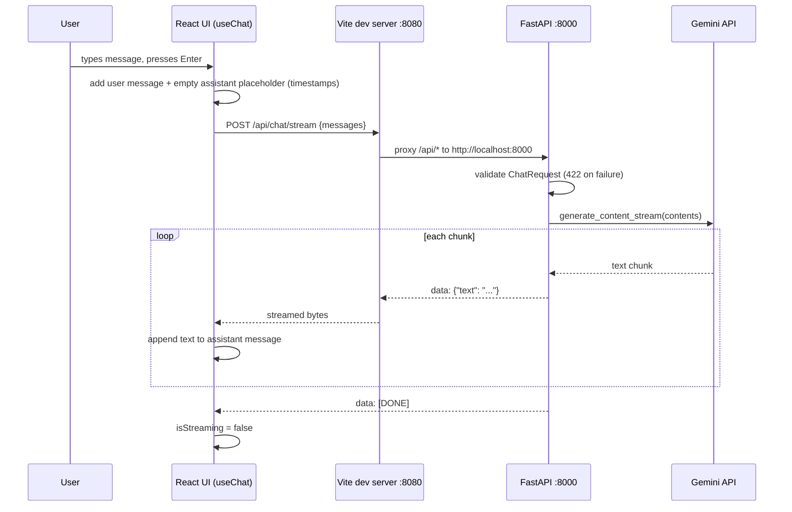

# Architecture

## 1. System Overview

A single-page chat application. A React frontend streams answers from Google Gemini through a thin FastAPI backend.

| Layer | Technology | Port | Role |
| --- | --- | --- | --- |
| Frontend | React 18, TypeScript, Vite, Tailwind CSS | 8080 | Chat UI, conversation state, SSE reader |
| Backend | Python 3.12, FastAPI, uvicorn | 8000 | Validates requests, calls Gemini, re-emits tokens as Server-Sent Events (SSE) |
| Model API | Google Gemini via the `google-genai` SDK | n/a | Generates the reply (default model `gemini-2.5-flash`) |

The backend holds no conversation state. The browser sends the full history on every request.

## 2. Data Flow



ASCII version:

```text
Browser (React, :8080)
   |  POST /api/chat/stream  (JSON: full history)
   v
Vite dev server proxy  (/api -> http://localhost:8000)
   |
   v
FastAPI (:8000)  routers/chat.py -> services/gemini.py
   |  generate_content_stream(model, contents)
   v
Gemini API
   |  text chunks
   v
FastAPI wraps each chunk:  data: {"text": "..."}\n\n
   |  ... then  data: [DONE]\n\n   (or  data: {"error": "..."}\n\n  and stop)
   v
Browser: fetch ReadableStream -> parse "data:" lines -> append to assistant bubble
```

Health check: `Header` calls `GET /api/health` on mount and every 30 seconds through the same proxy. A 2xx response shows "Connected". Any other status or a network error shows "Disconnected".

The proxy is only active in `npm run dev`. The backend also enables CORS for `http://localhost:8080`, so direct calls from that origin work too.

## 3. Backend Module Layout

```text
backend/
  app/
    main.py            FastAPI app, CORS (http://localhost:8080), mounts routers under /api
    config.py          Settings (pydantic-settings): GEMINI_API_KEY, MODEL_NAME, PORT; reads ".env" from the current working directory
    schemas/chat.py    ChatMessage, ChatRequest
    services/gemini.py GeminiService: builds Gemini contents, streams chunks as SSE strings
    routers/health.py  GET  /api/health
    routers/chat.py    POST /api/chat/stream (StreamingResponse, text/event-stream)
  tests/               pytest suite (health, chat streaming, validation)
  requirements.txt
  .env.example
```

- `config.py` creates one `settings` object at import time. The default for `GEMINI_API_KEY` is an empty string, so the app imports without a key.
- `GeminiService.client` creates the `genai.Client` lazily on first use.
- `GeminiService.build_contents` maps `assistant` to Gemini's `model` role and everything else to `user`. Only `content` is sent. `timestamp` is not forwarded to Gemini.
- `GeminiService.stream_chat` yields one `data: {"text": ...}` event per non-empty chunk. On `errors.APIError`, `httpx.HTTPError` or `ValueError` it logs only the exception class name, yields one generic `data: {"error": ...}` event, and stops without `[DONE]`. Otherwise it ends with `data: [DONE]`.

## 4. Frontend Component Hierarchy

```text
main.tsx
 └─ App.tsx                    owns useChat(); lays out the page
     ├─ Header                 title + connection badge (polls GET /api/health every 30 s)
     ├─ main
     │   ├─ MessageList        scrolls to the newest message; empty-state text
     │   │   └─ MessageItem*   sender badge, content (or typing dots), <time>
     │   └─ error banner       role="alert", shown when useChat().error is set
     └─ ChatInput              textarea (Enter sends, Shift+Enter newline), Send, Clear
```

```text
frontend/src/
  App.tsx, main.tsx, index.css
  components/  Header, MessageList, MessageItem, ChatInput (+ tests)
  hooks/useChat.ts      messages, isStreaming, error, sendMessage, clearChat
  services/api.ts       checkHealth(), streamChat() (fetch + SSE line parser)
  types/chat.ts         Role, Message, ChatRequest, StreamChunk, ConnectionStatus
```

- `useChat` holds the message list and uses an `AbortController` to cancel an in-flight stream on Clear or unmount. It ignores a new send while a stream is active.
- `api.ts` buffers bytes, splits on newlines and handles lines that start with `data:`. `[DONE]` calls `onDone`. A JSON `error` calls `onError`. A JSON `text` calls `onChunk`. Other lines and unparsable JSON are ignored. If the body ends without `[DONE]` or an error event, `onError("Stream ended unexpectedly")` is called. A non-2xx response calls `onError("Request failed (<status>)")`.

## 5. Message Sender and Timestamp Flow

1. **Creation (frontend).** `useChat.sendMessage` trims the input and creates two `Message` objects:
   - a user message: `role: "user"`, the text, `timestamp: new Date().toISOString()`;
   - an assistant placeholder: `role: "assistant"`, empty content, its own `timestamp` taken at the same moment. The timestamp marks when the reply began. It is not updated when streaming finishes.

   Each also gets a client-only `id` (`crypto.randomUUID()`).
2. **Request.** `streamChat` sends the history (all earlier messages plus the new user message, without the empty placeholder). Each entry is `{role, content, timestamp}`. The `id` is dropped.
3. **Backend.** `ChatMessage` validates `role` (`user` or `assistant`; `model` is normalized to `assistant`), requires non-empty `content`, and accepts an optional `timestamp` string without parsing it. The timestamp is accepted for contract completeness and is not used in the Gemini call.
4. **Streaming.** The response carries only text deltas. The backend does not send sender or timestamp data back. The frontend already owns the assistant placeholder, so it appends each delta to that message's `content`.
5. **Rendering.** `MessageItem` derives the sender label from `role` (`You` or `Gemini Assistant`) and shows the timestamp through `<time dateTime=...>` formatted with `toLocaleTimeString` (hours and minutes). An unparsable timestamp renders as empty text. While the assistant message is empty and streaming, typing dots show instead of content.
6. **Errors.** An error event or network failure sets `error` (shown in the banner). If the assistant message is still empty it is removed. If partial text already arrived, the partial message stays.
